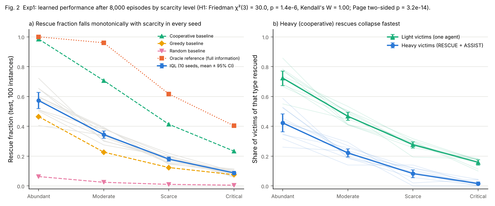

# The Last Rescue: Learning to Cooperate Under Resource Scarcity

Foundations of AI, Group 14, IIT Gandhinagar: Kshitij Suresh Giri (23110177), Panjari Maheshkumar Patel (23110236),
DV Snehal (23110083), Kshitish Madbhavi (24110175).

Full report: [`report/report.pdf`](report/report.pdf) (source: `scripts/build_report_content.py`).

## Question

Three agents search a 10 x 10 grid for six victims. Each agent has a private budget that is never refilled. Every move,
search and rescue costs budget. Half of the victims are *heavy*: one agent must RESCUE while a second agent ASSISTs on the
same cell in the same step. Each agent learns on its own with tabular Q-learning (independent Q-learning, IQL).

**Does scarcity make independent learners rescue fewer victims, and does it do so by breaking their cooperation?**

Scarcity level ρ is a fraction of a calibrated "just-enough" budget B_ref = 64 (horizon H = 105):

| Level | ρ | Budget per agent |
|---|---|---|
| Abundant | 1.0 | 64 |
| Moderate | 0.5 | 32 |
| Scarce | 0.3 | 19 |
| Critical | 0.2 | 13 |

## Answer in brief



- **Scarcity lowers performance strongly and monotonically** (H1). Rescue fraction 0.573 / 0.344 / 0.180 / 0.087 from
  Abundant to Critical; Friedman χ²(3) = 30.0, p = 1.4e-6, Page trend p = 3e-14; every seed in the same direction.
- **Learned teams beat random and greedy agents but stay far below a hand-designed cooperative team** (H3), e.g. 0.573
  vs 0.985 at Abundant. At Critical the advantage over greedy is not significant (p = 0.074).
- **Some cooperation measures fall with scarcity, others do not** (H2). Joint rescues (CR) and productive spending (PSS)
  fall, but both depend on the number of rescues. Assist efficiency (EAR), territory division (TDI) and spending
  inequality (Gini) show no significant trend.
- **Scarcity does not hurt more when cooperation is needed** (H5). In an otherwise identical world with only light
  victims, scarcity costs *more* rescue-fraction points (DiD = −0.248, 0/10 seeds positive). The sign changes on a log
  scale, so no cooperation-bottleneck claim is made.
- **No run converged** after 8,000 episodes (0 of 40 main runs meet the stability rule). All results are "at a fixed
  training budget".

Robustness of these findings to seven design choices (budget feature, role symmetry, reward split, initial Q-values,
dormant-agent updates, training partners, training length) is in Section 11.3 of the report and in
[`results/robustness/summary.md`](results/robustness/summary.md).

The modelling assumptions (map known in advance, no communication, symmetric roles at heavy victims, reward that favours
light victims, budget scale from a heuristic policy) are listed in Section 3.6 of the report.

## Setup

```bash
python3.13 -m venv .venv
source .venv/bin/activate            # Windows: .venv\Scripts\activate
pip install -r requirements.txt      # pinned versions used for every result
npm install                          # report rendering only (docx); also needs LibreOffice and poppler
```

## Quick start

```bash
python -m pytest -q                  # 269 tests, about 35 s
python scripts/run_all.py --quick    # whole pipeline at reduced scale (3 seeds x 3,000 episodes) -> results_quick/
python scripts/verify_results.py     # recompute the confirmatory statistics, check every claim and report number
python scripts/run_all.py --full     # the full study (about 2.5 h on 2 cores), then stats, figures, report
```

## All commands (in pipeline order)

```bash
python scripts/bench_env.py                 # environment speed -> results/logs/bench_env.txt
python scripts/make_sample_replays.py       # ASCII replays -> results/replays/phase1_*.txt
python scripts/validate_metrics.py          # metric construct-validity check -> results/phase2/
python scripts/make_phase2_replays.py       # baseline/oracle replays -> results/replays/phase2_*.txt
python scripts/run_calibration.py           # calibration -> results/calibration/
python scripts/plot_calibration.py          # calibration figures and tables
python scripts/make_instance_sets.py        # frozen instance seed lists -> results/calibration/instance_sets.json
python scripts/make_freeze_manifest.py      # SHA-256 of every frozen file (--check lists files changed since)
python scripts/run_pilot.py --baselines     # pilot baselines on validation (Abundant)
python scripts/run_pilot.py --variant P0    # learnability pilot -> results/pilot/P0/
python scripts/analyze_pilot.py P0          # pilot gate and figures
python scripts/run_experiments.py status    # main study: what is done / remaining (resumable)
bash scripts/run_phase5_chunk.sh "train --block main" "eval --kind learned" ...
python scripts/check_phase5_integrity.py    # every run and evaluation part present and well-formed
python scripts/phase5_summary.py            # seed-level tables -> results/phase5/
python scripts/make_phase5_manifest.py      # SHA-256 of all main-study artefacts
python scripts/run_stats.py                 # statistics from raw episodes -> results/stats/
python scripts/make_tables.py               # tables -> results/tables/
python scripts/make_figures.py              # figures -> results/figures/
python scripts/make_replays.py              # replays from test episodes -> results/replays/phase6_*
python scripts/run_robustness.py train --workers 6   # robustness blocks R1-R7 (exploratory, about 1 h on 7 cores)
python scripts/run_robustness.py eval --workers 6
python scripts/run_robustness.py summary    # -> results/robustness/summary.md
python scripts/verify_results.py            # independent verification and claims ledger; exits 1 on any mismatch
PYTHON=python bash scripts/build_report.sh  # report/report.docx and report.pdf from the result files
python scripts/make_manifest.py             # results/manifest.json (SHA-256 of every file)
```

## Layout

- `config/`: `default.yaml` (every constant), `calibration.yaml` (rules stated before calibration), `calibrated.yaml`.
- `src/tlr/`: environment (`env.py`, `mapgen.py`, `costs.py`, `observation.py`, `rewards.py`, `replay.py`), baselines
  and oracle (`baselines.py`, `oracle.py`, `evaluate.py`), metrics (`cooperation_metrics.py`, `metrics.py`), calibration,
  learning (`iql.py`, `train.py`, `experiments.py`), statistics (`stats.py`), helpers (`utils.py`).
- `scripts/`: one script per pipeline stage, `run_all.py` (`--quick` / `--full`), report build, verifier, manifests.
- `tests/`: 269 tests (rules, masking, budgets, stale information, feasibility, invariants, baselines, oracle, metrics on
  scripted episodes, IQL, experiments, statistics, robustness options, quick run).
- `docs/`: design specification, preregistration, pilot protocol, design decisions, deviations log, claims checked by
  the verifier, module owners.
- `results/`: calibration, pilot, 350 main-study training runs, raw test episodes, statistics, tables, figures,
  replays, logs, `robustness/` (R1-R7), `manifest.json`.
- `results_quick/`: output of the last `--quick` run (pipeline check, not study results).

## Who did what

Each member owns the modules listed below and defends them in the viva (details in
[`docs/module_owners.md`](docs/module_owners.md)).

| Member | Role | Main code |
|---|---|---|
| Kshitij Suresh Giri | problem formulation, calibration, statistics, integration, report | `calibration.py`, `stats.py`, `run_stats.py`, `verify_results.py`, report build |
| Panjari Maheshkumar Patel | environment, maps, resources, logging | `env.py`, `mapgen.py`, `costs.py`, `observation.py`, `replay.py` |
| DV Snehal | rewards, cooperation metrics, baselines, oracle, individual vs collective analysis | `rewards.py`, `cooperation_metrics.py`, `metrics.py`, `baselines.py`, `oracle.py` |
| Kshitish Madbhavi | Q-learning, training pipeline, experiments, ablations, figures | `iql.py`, `train.py`, `experiments.py`, `run_experiments.py`, `make_figures.py` |

## Glossary

| Term | Meaning |
|---|---|
| RF | rescue fraction: victims rescued / victims present |
| H0-H6 | the hypotheses fixed in `docs/preregistration.md` (H0 is a learnability gate) |
| A1-A8 | attribution and robustness analyses (mismatched teams, removed agent, all-light world, solo training, ...) |
| R1-R7 | robustness blocks added after the main study (exploratory) |
| P / N / C entries | pre-freeze revisions, notes and post-freeze corrections in `docs/deviations_log.md` |
| D entries | design decisions in `docs/design_decisions.md` |
| EAR, RSR, TDI, PSS, Gini, CR | cooperation metrics C1-C5 (definitions in `docs/phase0_design_spec.md` §3) |
| Oracle | full-information centralised planner used as a reference, not a learner |
